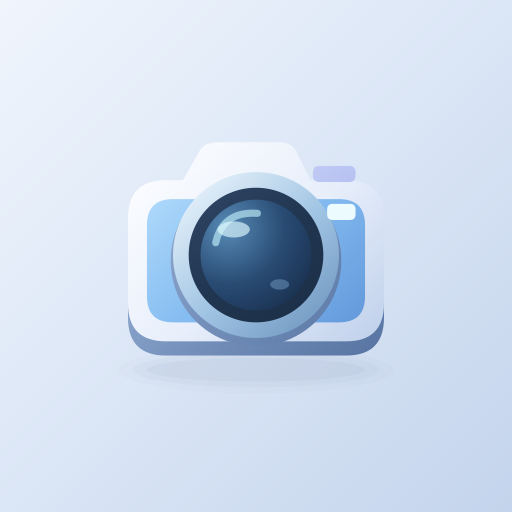

# USB Camera — دوربین USB

[Download / دریافت نسخه 1.0.3](https://github.com/cinaasadpour-hash/usb-camera/releases/tag/v1.0.3)

دوربین USB برای نمایش تصویر دوربین‌ها و میکروسکوپ‌های USB سازگار با UVC از طریق OTG ساخته شده است.

امکانات:
• مشاهده تصویر زنده دوربین USB سازگار
• ثبت عکس و ضبط ویدیو و مشاهده فایل‌های ثبت‌شده در گالری برنامه
• ثابت کردن تصویر، شبکه راهنما و کنترل‌های در دسترس دوربین
• ابزارهای اندازه‌گیری میکروسکوپ شامل فاصله، زاویه و مساحت، با کالیبراسیون مقیاس
• مقایسه تصویر با مرجع و تنظیم نحوه نمایش
• عیب‌یابی اتصال و مشاهده مشخصات دوربین
• فارسی و انگلیسی و پوسته روشن، تیره یا مطابق گوشی

به گوشی دارای USB Host/OTG، مبدل مناسب و دوربین USB سازگار نیاز دارید. وضوح، فرمت تصویر و کنترل‌ها به قابلیت دوربین و گوشی بستگی دارند. اندازه‌گیری به کالیبراسیون صحیح با مرجع معلوم نیاز دارد؛ پس از تغییر فاصله یا بزرگ‌نمایی، مقیاس را دوباره بررسی کنید. این ابزار برای اندازه‌گیری پزشکی یا ایمنی طراحی نشده است. ضبط صدا در نسخه فعلی در دسترس نیست.

برنامه دارای تبلیغات است. فایل‌های ثبت‌شده روی گوشی ذخیره می‌شوند.

USB Camera displays compatible UVC USB cameras and microscopes connected through OTG.

Features:
• Live preview from a compatible USB camera
• Photo capture, video recording and a gallery of captured files
• Freeze frame, guide grid and supported camera controls
• Microscope tools for distances, angles and areas, with scale calibration
• Reference-image comparison and display controls
• Connection diagnostics and camera information
• Persian and English, with light, dark and system themes

Requires a USB Host/OTG-capable phone, a suitable adapter and a compatible USB camera. Available resolutions, video formats and controls depend on the camera and phone. Measurements require correct calibration against a known reference; recheck the scale after changing distance or magnification. This is not a medical or safety measurement instrument. Audio recording is unavailable in the current version.

Contains advertising. Captured files are saved on your device.

Package: `com.sinatools.usbcamera` · Android 7.0+ · Version 1.0.3 (4)

[Privacy / حریم خصوصی](PRIVACY.md)
